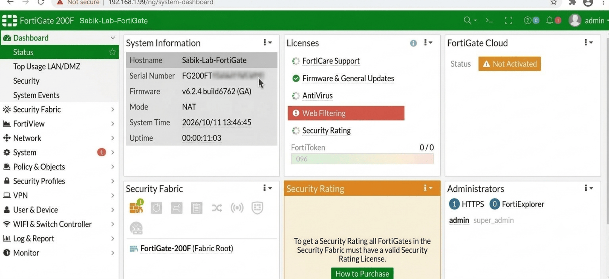
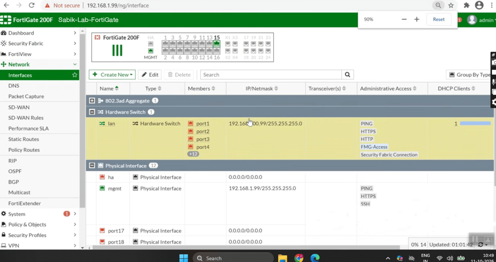

# Module 1: System Status Audit and Interface Topology Mapping

## Overview
Before applying security policies, an initial audit of the FortiGate appliance was conducted to verify system resource allocation, active licenses, operational health, and physical interface availability.

### Audit Observations
* **Appliance Model:** FortiGate Virtual Appliance (FortiOS v6.2.4).
* **System Health:** CPU and RAM utilization were verified within normal operational thresholds.
* **Security Fabric & Services:** Verified active licenses for threat protection modules prior to rule enforcement.

---

## Physical and Logical Interface Architecture
Network interfaces define the security perimeter by separating untrusted external networks from trusted internal zones.

### Key Interface Mapping
1. **WAN Interface (`port15`):** Designated as the Egress/Untrusted zone connected toward the ISP router.
2. **LAN Interface (`lan`):** Configured as a logical Hardware Switch binding physical ports (`port1` through `port14`) into a single layer-2 broadcast domain.
3. **Management Boundaries:** Distinct administrative access parameters were enforced on logical boundaries to prevent unauthorized exposure.
