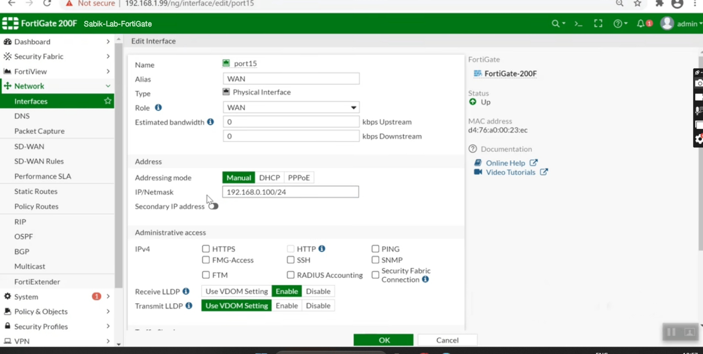
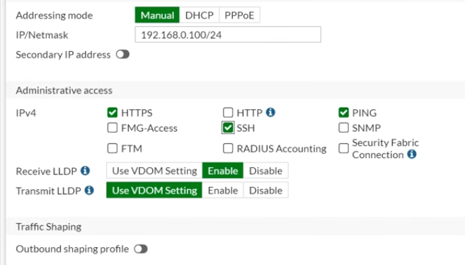

# Module 2: WAN Interface Configuration and Management Access Hardening

## Overview
The WAN boundary serves as the primary ingress and egress gateway connecting the internal network to external transit providers. Proper IP assignment and management interface isolation are critical to prevent perimeter exploitation.

## Static IP Addressing
Configured static IPv4 parameters on `port15` to establish a persistent connection with the ISP gateway.

### Configuration Parameters
* **Interface:** `port15` (WAN)
* **Addressing Mode:** Manual (Static)
* **IP / Subnet Mask:** `192.168.0.100/255.255.255.0`
* **Upstream Gateway IP:** `192.168.0.2`

---

## Administrative Access Lockdown (To-The-Box Security)
Administrative access settings govern how security personnel reach the FortiGate management plane (To-the-Box traffic). To minimize external exposure, strict protocol controls were implemented.

### Administrative Protocol Security Controls
* **HTTPS (Enabled):** Grants encrypted web-based GUI management access over TLS.
* **SSH (Enabled):** Grants encrypted command-line interface (CLI) administrative access over Port 22.
* **PING (Enabled):** Permits ICMP echo requests for basic WAN reachability diagnostics.
* **Insecure Protocols (Disabled):** Unencrypted protocols such as HTTP and Telnet were explicitly disabled to protect administrative credentials from plain-text exposure or sniffing.
