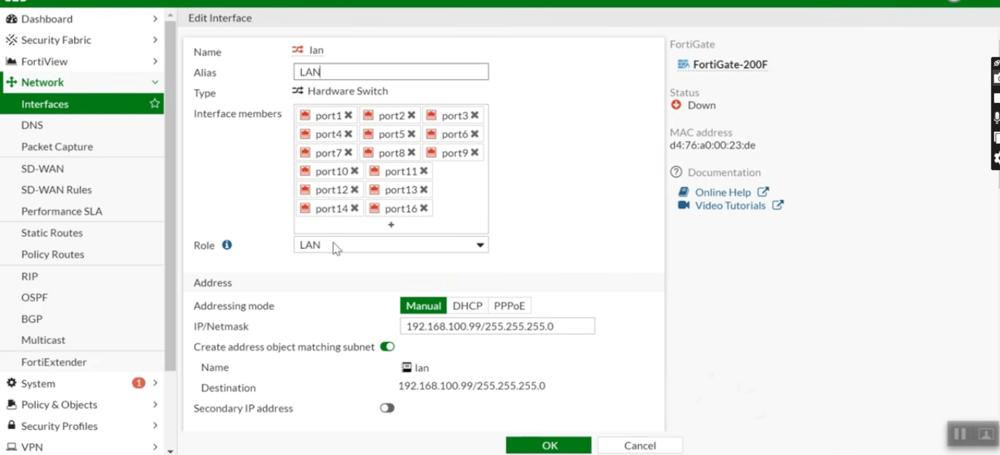
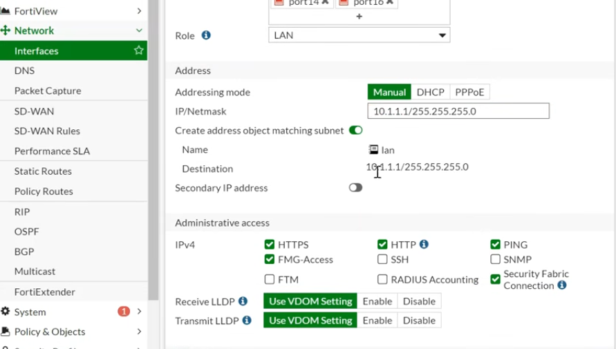
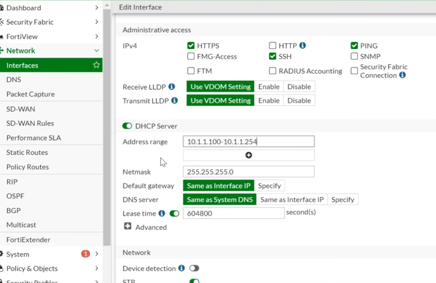

# Module 3: LAN Switch Interface, Gateway Allocation, and DHCP Services

## Overview
The internal network architecture relies on a consolidated Hardware Switch interface for local endpoint communication, paired with an automated DHCP service to ensure correct network addressing and DNS resolution across connected hosts.

## Hardware Switch Aggregation
Physical ports (`port1` through `port14`) were aggregated into a single logical hardware switch named `lan`. This provides high-speed local switching without consuming additional firewall routing interfaces.

### Interface Parameters
* **Interface Name:** `lan` (Hardware Switch)
* **Role:** LAN
* **Addressing Mode:** Manual
* **Gateway IP / Netmask:** `10.1.1.1/255.255.255.0`

---

## Internal DHCP Server and Local Management
To automate client endpoint configuration, an integrated DHCP server scope was provisioned directly on the LAN interface.

### DHCP Scope & Network Options
* **Address Range:** `10.1.1.100` – `10.1.1.254`
* **Subnet Mask:** `255.255.255.0`
* **Default Gateway:** `Same as Interface IP` (`10.1.1.1`)
* **DNS Configuration:** Specified explicitly to `8.8.8.8` (Google Public DNS) to ensure internal hosts resolve external domain names.
* **Administrative Access (LAN):** Enabled HTTPS, HTTP, and PING for local network management and troubleshooting.
