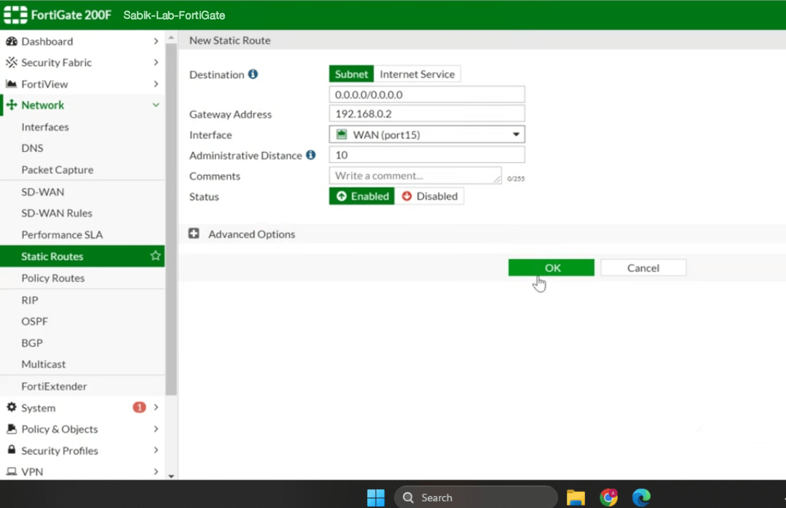

# Module 4: Static Default Gateway Route Provisioning

## Overview
Firewalls require explicit routing instructions to forward transit traffic (Through-the-Box traffic) destined for networks outside local subnets. A static default route was implemented to direct all unknown outbound traffic toward the ISP next-hop router.

## Routing Table Configuration

| Parameter | Configuration Value | Technical Purpose |
| :--- | :--- | :--- |
| **Destination IP / Mask** | `0.0.0.0/0.0.0.0` | Default route matching all non-local destination addresses. |
| **Gateway IP** | `192.168.0.2` | The upstream ISP next-hop router IP address. |
| **Interface** | `port15` | Egress WAN interface connected to the external network segment. |
| **Administrative Distance** | `10` | Primary active route priority in the routing table. |

## Outbound Traffic Flow Logic
1. An internal endpoint (`10.1.1.100`) sends a request to an external IP (e.g., `8.8.8.8`).
2. The packet hits the FortiGate LAN interface (`10.1.1.1`).
3. The routing engine evaluates the destination IP against its routing table.
4. Because the destination is external, it matches the `0.0.0.0/0` static default route and forwards the packet out via `port15` to gateway `192.168.0.2`.
