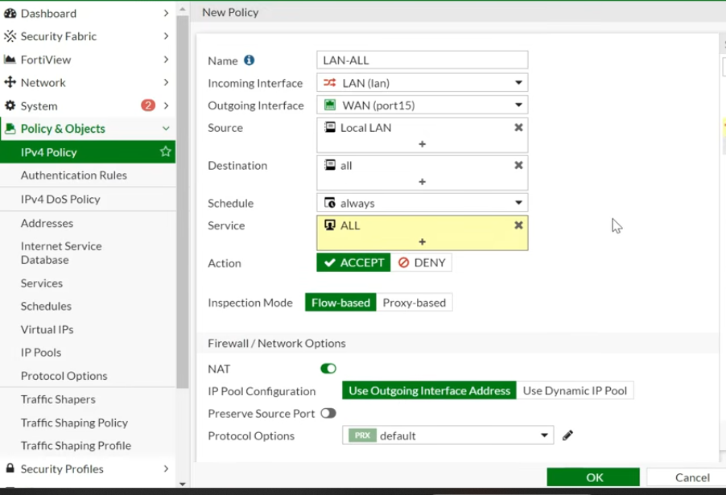
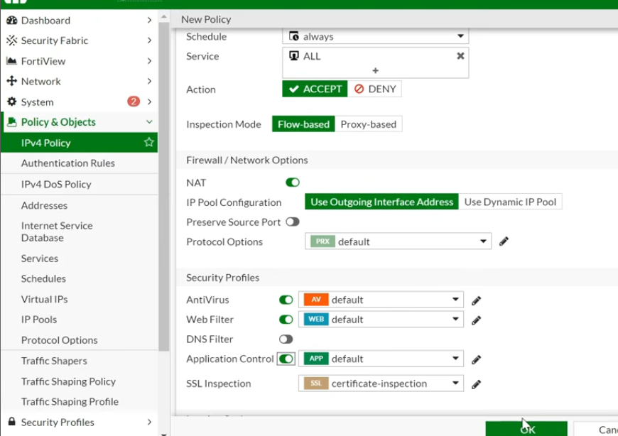
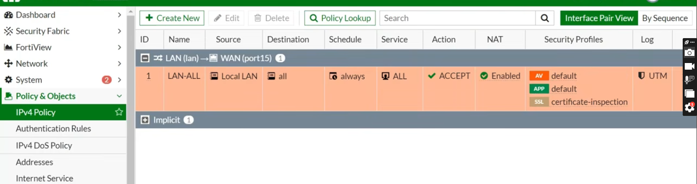
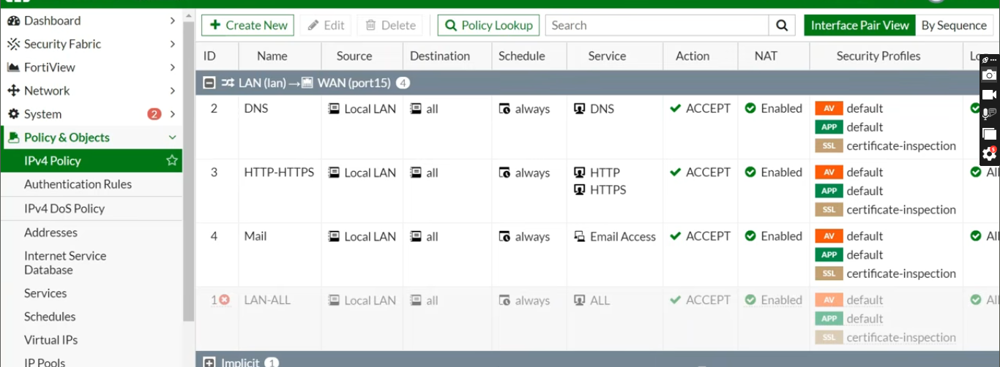

# Module 5: Firewall Policy Segmentation and UTM Security Profiles

## Overview
Security rules regulate transit traffic moving between the trusted internal zone (`lan`) and untrusted external zone (`port15`). To achieve defense-in-depth, broad "allow-all" rules were phased out in favor of granular, service-specific policies paired with Unified Threat Management (UTM) profiles.

---

## Phase 1: Baseline Rule Creation
Initially, a general `LAN-ALL` policy was established with Network Address Translation (NAT) enabled to confirm network reachability.

### NAT Logic
* **Source NAT (SNAT):** Enabled (`Use Outgoing Interface Address`).
* **Function:** Replaces private internal host IPs (`10.1.1.x`) with the public WAN interface IP (`192.168.0.100`) during egress, enabling outbound routing across the internet.

---

## Phase 2: UTM Security Profile Attachment
To protect endpoints against malware and unauthorized web categories, threat inspection profiles were attached to active policy flows.

### Applied Security Profiles
* **Antivirus (AV):** Scans passing traffic streams for known signature-based malware strains.
* **Web Filter:** Blocks malicious, phishing, and non-work-related URL categories.
* **Application Control:** Inspects layer-7 traffic to detect and restrict dangerous application behaviors.
* **SSL Inspection:** Enables deep/certificate inspection on encrypted TLS sessions.

---

## Phase 3: Least Privilege Granular Rule Enforcement
To eliminate single points of compromise, the broad `LAN-ALL` policy was **disabled**, replacing it with strict, service-specific granular rules.

### Granular Policy Breakdown

1. **DNS Policy (Sequence 2):**
   * **Source:** `Local LAN` (`10.1.1.0/24`) | **Destination:** `ALL`
   * **Service:** `DNS` (Port 53 UDP/TCP) | **Action:** `ACCEPT`
   * **Rationale:** Permits domain name resolution required for system connectivity while isolating DNS traffic flows.

2. **HTTP-HTTPS Policy (Sequence 3):**
   * **Source:** `Local LAN` (`10.1.1.0/24`) | **Destination:** `ALL`
   * **Service:** `HTTP`, `HTTPS` (Ports 80, 443) | **Action:** `ACCEPT`
   * **Rationale:** Enables general secure web browsing protected by active Antivirus and Web Filtering profiles.

3. **Mail Policy (Sequence 4):**
   * **Source:** `Local LAN` (`10.1.1.0/24`) | **Destination:** `ALL`
   * **Service:** `Email Access` (SMTP/POP3/IMAP) | **Action:** `ACCEPT`
   * **Rationale:** Allows corporate email traffic while blocking non-essential ports.

4. **Implicit Deny (Default Sequence):**
   * Any traffic not matching the above explicit rules is automatically dropped by FortiOS's built-in Implicit Deny rule, significantly reducing the attack surface.
