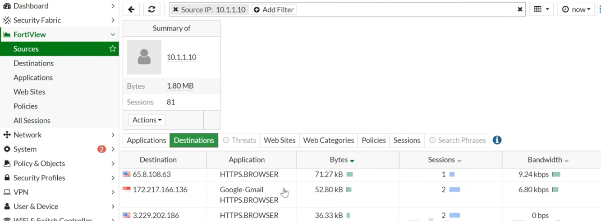
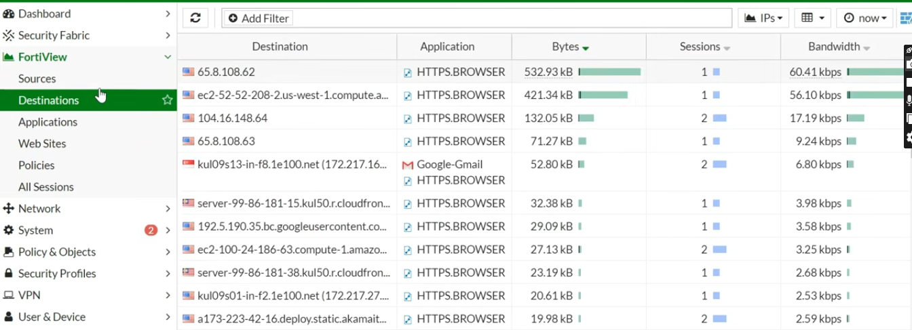

# Module 6: Operational Traffic Monitoring and SOC Incident Triage

## Overview
FortiView provides real-time visibility into passing network sessions, allowing SOC Analysts to perform threat hunting, identify bandwidth anomalies, and verify security profile execution.

---

## Host-Based Session Analysis
Monitored internal host connections to verify IP assignment, session counts, and bandwidth consumption.

### SOC Triage Metrics
* **Source IP Tracked:** Endpoint host `10.1.1.10` verified on the `lan` interface.
* **Session Verification:** Confirmed active concurrent sessions originating from internal endpoints.
* **Bandwidth Monitoring:** Tracked upload/download throughput to establish baseline user activity patterns and detect potential data exfiltration.

---

## Destination & Application Inspection
Analyzed outbound connection targets and layer-7 application categories to verify traffic legitimacy.

### Security Audit Findings
1. **Application Identification:** Evaluated real-time protocols (Web Browsing, DNS queries, HTTPS traffic) passing through active policies.
2. **Destination IP Tracking:** Cross-referenced destination IP addresses with external threat intelligence indicators.
3. **Policy Compliance Verification:** Confirmed that traffic strictly aligned with the configured granular rules (DNS, HTTP/HTTPS, Mail), proving that unauthorized protocols (e.g., SSH, FTP) were successfully blocked by the implicit deny rule.
